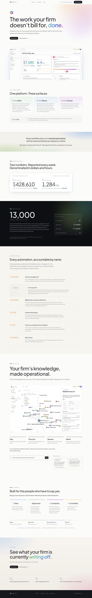

# Exercici004: Strata

Exercici en **grups de dues persones**.

Reprodueix la pàgina principal de **[Strata](https://www.strata.ai/#)** amb **HTML i CSS**, i fes que s'adapti a ordinador i mòbil.

L'objectiu és practicar la maquetació responsive: estructura, tipografia, colors, degradats, espais, alineacions i distribució dels continguts.

## Material de referència

- [Descarrega el ZIP d'assets de Strata](./assets/exerciciStrata.zip).
- [Consulta la captura completa d'escriptori](./assets/exerciciStrata.png).
- El ZIP conté només dues carpetes: `assets`, amb els logotips, les imatges, les fonts locals i els scripts de l'animació, i `referencies`, amb les captures d'escriptori (**1440 px**) i mòbil (**390 px**), els textos i la procedència de l'animació. Es conserven les llicències de les fonts i les biblioteques.

Fes servir les captures del ZIP com a referència de la pràctica, no miris el codi de la pàgina real, si la web real canvia fes-la com a les captures.



## Abast de la pràctica

Cal reproduir **una sola pàgina**, des de la capçalera fins al peu. Mantén els textos en anglès; els tens a `referencies/textos.txt` dins del ZIP.

La pràctica se centra en la maquetació. Els comptadors, la consulta d'Atlas i els blocs que canvien amb el temps es poden representar en un **estat estàtic**, amb les dades visibles a les captures. No cal programar intel·ligència artificial, formularis funcionals ni altres pàgines de Strata. Per animar el fons del hero, incorpora els scripts facilitats seguint els passos de l'apartat «Com incloure l'animació del hero».

El fons del **hero** original combina degradats CSS amb un gràfic 3D de nodes i connexions, dibuixat en un `<canvas>` amb JavaScript (Three.js i 3d-force-graph). No és un vídeo ni un SVG animat. El ZIP inclou el [script original d'aquesta animació](https://www.strata.ai/hero-graph.js) i les dues biblioteques que necessita; no cal que programis el gràfic 3D.

## Seccions que cal reproduir

1. **Capçalera**: logotip, navegació interna i enllaç «Book a Demo». Ha de continuar visible quan es fa scroll.
2. **Hero**: símbol de Strata, títol gran amb una paraula en degradat, text introductori, enllaços d'acció i imatge de Nexus.
3. **Platform**: tres targetes per a Atlas, Nexus i Canvas, i una franja inferior per a Core.
4. **Franja de missatge**: text centrat sobre un fons amb degradats suaus.
5. **Operational Value**: panell amb les dues mètriques de recuperació d'ingressos i capacitat, amb les seves etiquetes i dades.
6. **From the Field**: secció fosca amb la xifra destacada de 13.000 factures, text explicatiu i fitxa de dades.
7. **Workflows**: llista dels sis serveis, amb etiquetes, títols, descripcions, separadors i fletxes.
8. **Atlas**: títol, imatge del producte, els quatre passos (Map, Structure, Operate i Refine), exemple estàtic de consulta i dues targetes de nodes editables. El bloc de resposta de la consulta és opcional.
9. **Governance**: quatre targetes (Cited, Approved, Contained i Controlled), esquema dels quatre passos d'una execució i franja de garanties.
10. **Get Started i peu**: crida final a l'acció, tres blocs de confiança, logotip, enllaços i copyright.

## Requisits tècnics

- Fes servir **HTML semàntic**: `header`, `nav`, `main`, `section` i `footer`, amb un únic `h1` i una jerarquia coherent de títols.
- Escriu els estils en un **arxiu CSS extern**.
- Maqueta SENSE **Grid**, preferiblement amb **FlexBox**. Fes servir un contenidor centrat amb amplada màxima i marges laterals a les seccions que ho permeten.
- Inclou `<meta name="viewport" content="width=device-width, initial-scale=1">`.
- Fes servir les fonts locals del ZIP: **Plus Jakarta Sans** per al text principal i **JetBrains Mono** per a etiquetes i dades. Carrega-les amb la capçalera HTML de l'apartat següent.
- Utilitza els logotips i les dues imatges de producte del ZIP amb **rutes relatives**. Conserva'n les proporcions i afegeix un text alternatiu adequat.
- Construeix les targetes, els textos, els botons, els separadors i els degradats amb HTML i CSS. Les captures completes són una referència visual, no una imatge per substituir la pàgina.
- Els enllaços de navegació han de portar a les seccions corresponents. Els enllaços «Book a Demo» poden portar al bloc final de la teva pàgina o a la pàgina de demo original.
- Els enllaços han de tenir estats visibles de `:hover` i `:focus-visible`.
- Escriu el teu propi HTML i CSS, **sense frameworks de maquetació ni JavaScript propi**. L'única excepció són els scripts facilitats per al fons animat del hero: els has d'incloure, però no cal modificar-los.

## Capçalera HTML per copiar

Copia aquest bloc `<head>` al teu `index.html`. Com que el contingut és en anglès, fes servir `<html lang="en">` a l'inici del document.

```html
<head>
  <meta charset="UTF-8">
  <meta name="viewport" content="width=device-width, initial-scale=1">
  <title>Strata — Exercici004</title>
  <link rel="icon" href="assets/img/strata-icon.svg" type="image/svg+xml">
  <link rel="stylesheet" href="assets/fonts/fonts.css">
  <link rel="stylesheet" href="estils.css">
  <script defer src="assets/js/vendor/three.min.js"></script>
  <script defer src="assets/js/vendor/3d-force-graph.min.js"></script>
  <script defer src="assets/js/hero-graph.js"></script>
</head>
```

## Com fer servir les fonts locals

1. Copia tota la carpeta `assets/fonts` del ZIP al teu projecte, sense canviar-ne els noms ni l'estructura.
2. Carrega `assets/fonts/fonts.css` abans d'`estils.css`, tal com mostra el `<head>` anterior. Aquest fitxer ja conté les declaracions `@font-face` que relacionen cada família i pes amb el seu fitxer `.ttf`.
3. Al teu `estils.css`, assigna les famílies als elements que les han de fer servir. Per exemple:

```css
body {
  font-family: 'Plus Jakarta Sans', sans-serif;
  font-weight: 400;
}

h1, h2, h3 {
  font-weight: 500;
}

.etiqueta, .dada {
  font-family: 'JetBrains Mono', monospace;
  font-weight: 400;
}
```

Les classes `.etiqueta` i `.dada` són exemples: aplica-les als elements corresponents del teu HTML o adapta els selectors als noms del teu projecte.

## Com incloure l'animació del hero

### 1. Copia els scripts i carrega'ls en ordre

Copia tota la carpeta `assets/js` del ZIP al teu projecte. Hi trobaràs:

- **`vendor/three.min.js`**: biblioteca per dibuixar gràfics 3D amb WebGL.
- **`vendor/3d-force-graph.min.js`**: biblioteca que crea el gràfic de nodes i connexions.
- **`hero-graph.js`**: script de Strata que prepara el gràfic, mou la càmera i el col·loca al fons del hero.

La capçalera HTML anterior ja inclou els tres `<script>`. Mantén-ne **l'ordre** i l'atribut **`defer`**: permet descarregar-los mentre es llegeix l'HTML i executar-los en ordre quan el document ja està preparat. Si ja els has copiat al `<head>`, no els tornis a afegir al final del document.

Els fitxers es carreguen localment: no necessites React, npm ni una connexió a Internet. Conserva els fitxers de llicència de `assets/js/vendor` i indica la procedència del script al README del projecte; la tens a `referencies/animacio-origen.txt`.

### 2. Prepara l'estructura HTML del hero

El script busca una secció amb la classe **`hero`**. A dins, posa els continguts en un element amb la classe **`container`**, fill directe de la secció. Per exemple:

```html
<section class="hero">
  <div class="container">
    <!-- Aquí van el logotip, el títol, els textos,
         els enllaços i la imatge de Nexus del teu hero. -->
  </div>
</section>
```

Mantén aquestes dues classes encara que n'afegeixis d'altres. Fes servir una sola secció `.hero` i dona-li espai amb el contingut i els teus estils: si no té alçada, el gràfic tampoc es podrà veure. **No has d'escriure cap `<canvas>`**: el script afegeix automàticament un bloc `.hero-graph` amb el llenç de l'animació.

### 3. Col·loca l'animació darrere del contingut

Afegeix aquests estils a `estils.css`. Preparen les capes i un fons de degradats; completa la maquetació del hero amb les teves mides, espais i tipografia.

```css
.hero {
  position: relative;
  isolation: isolate;
  overflow: hidden;
  background:
    radial-gradient(ellipse at 80% 15%, #f3dce8, transparent 60%),
    radial-gradient(ellipse at 60% 0%, #fae6d1, transparent 55%),
    #fbfbfa;
}

.hero-graph {
  position: absolute;
  inset: 0;
  z-index: 0;
  pointer-events: none;
  -webkit-mask-image: radial-gradient(ellipse, #000 60%, transparent 100%);
  mask-image: radial-gradient(ellipse, #000 60%, transparent 100%);
}

.hero-graph canvas {
  display: block;
  background: transparent;
  pointer-events: none;
}

.hero > .container {
  position: relative;
  z-index: 1;
}

@media (max-width: 767px), (prefers-reduced-motion: reduce) {
  .hero-graph {
    display: none !important;
  }
}
```

`position: relative` fa que el gràfic es posicioni respecte del hero. Els `z-index` mantenen els textos i els enllaços per davant; `pointer-events: none` evita que el gràfic intercepti els clics. La màscara difumina les vores del gràfic perquè es fongui amb el degradat.

### 4. Comprova el resultat

Obre la pàgina amb un servidor local, com ara **Live Server** de VS Code, i comprova-la a una amplada de **1440 px**. Hauries de veure els nodes i les connexions girant suaument darrere del contingut, amb els enllaços encara accessibles.

Per sota de **768 px**, el gràfic s'amaga i queda el degradat. El script no el crea si obres la pàgina directament en mòbil; si després amplies la finestra a escriptori, **recarrega la pàgina** per iniciar-lo. També s'amaga quan el sistema té activada la preferència de reduir el moviment. Si el navegador no pot crear el context WebGL, es manté el fons CSS.

Si no apareix a escriptori, revisa les rutes dels scripts, l'ordre de càrrega, la classe `.hero`, l'alçada de la secció i els errors de la consola del navegador. No cal modificar el codi JavaScript per completar la pràctica.

## Adaptació a mòbil

Fes servir `@media` per adaptar la distribució segons l'espai disponible. Com a mínim, hi ha d'haver una adaptació per sota de **768 px**.

## Estructura del projecte

Descomprimeix el ZIP i copia la carpeta `assets` al teu projecte. Les captures i els textos de `referencies` són material de consulta.

```text
DAM1M04-Exercici004/
├── index.html
├── estils.css
├── assets/
│   ├── img/
│   ├── fonts/
│   └── js/
│       ├── hero-graph.js
│       └── vendor/
└── README.md
```

## Comprovacions abans d'entregar

- Revisa la pàgina a **1440 px**, **768 px** i **390 px**, i comprova que continua sent usable a **360 px**.
- Compara-la amb les captures: seccions, colors, tipografia, amplades, espais i alineacions.
- Comprova que no hi ha desplaçament horitzontal, elements superposats ni contingut tallat.
- Comprova els enllaços interns i la navegació amb el teclat.
- Comprova que les imatges i les fonts es carreguen des del projecte, sense dependre de Google Fonts ni de la web de Strata.
- Comprova que l'animació del hero funciona a escriptori, que no tapa els enllaços i que en mòbil es manté el degradat sense el gràfic 3D.
- Explica al `README.md` com obrir la pàgina, les decisions d'adaptació a mòbil i la procedència dels recursos.

Es valoraran la fidelitat visual, l'adaptació responsive, l'estructura de l'HTML i l'organització i reutilització del CSS.

Els logotips, les imatges, els textos i el disseny de referència provenen de [Strata](https://www.strata.ai/#). Indica aquesta procedència al `README.md` i identifica el projecte com una reproducció acadèmica.

## Entrega

Entregueu l'exercici com un nou repositori a GitHub anomenat **DAM1M04-Exercici004**, d'un dels dos alumnes.

Al repositori del GitHub hi ha d'haver aportacions dels dos alumnes, és a dir que qui tingui el repositori l'ha de compartir amb el seu company.

Copia l'enllaç del repositori a l'espai d'entrega del Moodle de l'assignatura.
